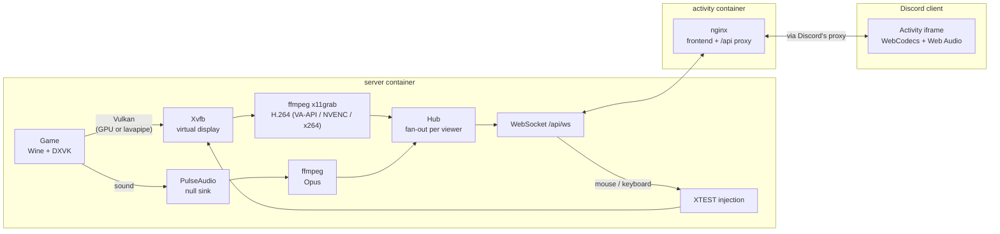

# Sigismundo

A self-hosted Discord Activity for hosting PC party games (Jackbox and friends) from a server box: it runs the game under Wine on a headless display and streams it, with sound, into a Discord Activity in your voice channel. Whoever opened the Activity first controls the game with mouse and keyboard from the Activity; everyone else joins on their phones as usual.

Bring your own games: launcher-free copies, mounted into the container with a small manifest.

## How it works

1. In a voice channel, open Sigismundo from the Activities shelf (rocket button) and pick a game; whoever opened it first is in control (bottom-left of the menu).
2. The game fills the Activity; the host's mouse and keyboard go straight to it. Players read the room code off the stream and join on jackbox.tv.
3. Quitting the game, Ctrl+Shift+X → Stop game, or 10 minutes without anyone watching ends it and brings back the catalog.

Two parts, two images: `server/` (API, game pipeline) and `activity/` (the Activity frontend, nginx proxying `/api` to the server).

## Run with Docker

1. Create a Discord application. From OAuth2, note the client id and secret and add any redirect (e.g. `https://127.0.0.1`, unused but required). Enable Activities and map the root `/` to your public HTTPS host (no scheme). Install the app so it shows up in voice channels' Activities shelf.
2. `cp server/.env.example server/.env` and fill in `CLIENT_ID`, `CLIENT_SECRET`, `OWNER_IDS`.
3. Put your games in `./games` with a `catalog.yaml`, see [server/catalog.example.yaml](server/catalog.example.yaml).
4. `docker compose up -d --build`, and put a reverse proxy with TLS in front of port 8080 (the activity container).
5. Optional but recommended: give it the GPU. Uncomment `devices`/`group_add` in the compose file and set `RENDER_GID` to `stat -c %g /dev/dri/renderD128`. Games then render on the GPU and the stream is encoded there too (VA-API on Intel/AMD, NVENC on NVIDIA); without one, everything runs on the CPU, which can take most of a small box. Knobs: `GPU_DEVICE`, `GPU_RENDER`, `VIDEO_ENCODER` in [server/.env.example](server/.env.example).

Try it without Discord (no Discord app needed, anyone reaching it can log in as anyone): `SIGISMUNDO_MODE=local docker compose up --build`, then open `http://localhost:8080/?user=1&name=me`.

## Under the hood

There is no Discord bot: nothing joins voice and there are no slash commands. Discord only hosts the Activity, an iframe that loads the frontend through Discord's proxy, and video, audio and input all travel over one WebSocket between that iframe and the server.

### Sessions and control

One game runs at a time, shared by everyone who opens the Activity, from any voice channel or server. The first viewer of an empty Activity becomes the controller. Only the controller's input reaches the game, and only the controller or an owner (`OWNER_IDS`) can start or stop games. Owners can also take control at any time. If the controller is gone from the Activity for a minute, control passes to whoever has been watching longest. A session ends when the game exits, when someone stops it (Ctrl+Shift+X), when part of the pipeline dies, or after `IDLE_TIMEOUT` (10 minutes) with no viewers.

### The pipeline, per session

Each session starts from scratch, in this order (`server/internal/runner`):

1. **Display:** `Xvfb`, a virtual X server whose screen is a block of RAM, at `STREAM_WIDTH`x`STREAM_HEIGHT` (1280x720 by default).
2. **Audio:** a private `pulseaudio` with a null sink, so the game's sound is captured and never played anywhere. On a desktop with PipeWire, a null sink is added to the running sound server instead (`AUDIO_MODE=host`).
3. **Wine:** the prefix in `/data/wine` is created on the first run (game saves persist there), and DXVK's `d3d11`/`dxgi` are copied into it each launch. The game runs inside `wine explorer /desktop=…`, a virtual desktop that pins it to the capture size, since Xvfb can't change resolution.
4. **Input:** mouse and keyboard events from the controller are injected into Xvfb with XTEST (pure Go, no xdotool).
5. **Encoders:** two `ffmpeg` processes write to pipes that the server reads:
   - video: `x11grab` → H.264 constrained baseline, constant bitrate (`STREAM_VIDEO_KBPS`), no B-frames, a keyframe every 2 seconds, SPS/PPS repeated on every keyframe so late joiners can start decoding, and an access unit delimiter before every frame so the server can split frames without parsing them.
   - audio: the null sink's monitor → Opus, 20ms frames in low-delay mode, in Ogg pages of 20ms so packets aren't batched.
6. **Watching the game:** launchers often hand off to a child process, so the server polls `/proc` for a process named like the exe instead of waiting on `wine`. If it never shows up within 90 seconds, the session fails; once it has come and gone, the session ends.

Stopping kills the Wine server, then every process group in reverse order.

### Rendering and the GPU

Games render through DXVK, which turns Direct3D 11 into Vulkan. Wine's own OpenGL path renders D3D11 games black without a GPU.

At boot the server picks a GPU (`server/internal/runner/gpu.go`) and logs the choice as `gpu: device …, render on …, encoder …`:

- **Device** (`GPU_DEVICE`): the first `/dev/dri/renderD*` it can open. If one exists but the container can't open it, it logs a hint to add the device's group.
- **Rendering** (`GPU_RENDER`): Xvfb has no GPU support (no DRI3), so Mesa won't show GPU-rendered frames on it and Vulkan quietly falls back to lavapipe, which renders on the CPU. Setting `MESA_VK_WSI_DEBUG=sw` makes Mesa render on the GPU and copy each finished frame into Xvfb. `MESA_VK_DEVICE_SELECT` pins the chosen GPU when there are several. This works with Mesa drivers (Intel, AMD, nouveau); the proprietary NVIDIA driver can't present to Xvfb, so rendering stays on lavapipe there.
- **Frame cap:** `DXVK_FRAME_RATE` is set to `STREAM_FPS`; frames beyond what the stream sends would be wasted work.
- **Encoder** (`VIDEO_ENCODER`): NVENC (NVIDIA only), then VA-API (Intel, AMD), then libx264. Each candidate has to pass a short test encode at boot, so an encoder the hardware or driver doesn't support is skipped instead of failing mid-session. For VA-API it tries normal and low-power modes (Debian's free Intel driver only has low-power H.264), and colour conversion on the GPU before falling back to the CPU.

Any of these environment variables you set yourself take precedence. Without a GPU everything runs on the CPU, which on a 4-core N150 is about 70–80% CPU for one Jackbox game. With the GPU it's about 30%, mostly Wine and the game itself.

What stays on the CPU even with a GPU: copying each frame into Xvfb, out of it again for capture, and back to the GPU for encoding. Games that render with Direct3D 9 or OpenGL instead of D3D11 also still render on the CPU, since only D3D11 goes through DXVK and Vulkan.

### Getting it to the browser

Each encoded video frame or audio packet becomes one binary WebSocket message: `kind (1 video, 2 audio) | flags (1 = keyframe) | timestamp µs | payload`. Timestamps are the time the server received the data, on one clock for both streams, which is what keeps them in sync.

The **hub** (`server/internal/stream`) fans frames out to every viewer. Each viewer has a buffer; if a slow viewer's buffer fills, its frames are dropped and its video skips ahead to the next keyframe, so the decoder never sees a gap. A new viewer first gets the frames since the last keyframe, so the picture appears immediately instead of after up to 2 seconds.

nginx in the activity container proxies `/api` and the WebSocket to the server with buffering off. Discord's proxy sits in front of that.

### In the Activity

- **Sign-in:** the Discord SDK's `authorize` gives a code; the server trades it for the user's identity with `CLIENT_SECRET` and returns a signed token (`SESSION_SECRET`, valid 12 hours) for the WebSocket. Outside Discord, local mode hands out tokens for any user instead.
- **Video:** WebCodecs `VideoDecoder`, configured from the codec details in the stream itself, with hardware decoding preferred. If decoding falls behind, it skips to the next keyframe.
- **Audio:** WebCodecs `AudioDecoder`, or a WASM Opus decoder where the browser lacks Opus support. Packets play back to back about 120ms ahead to absorb network jitter. If a backlog builds past 250ms, it restarts at 120ms so the delay doesn't keep growing.
- **Sync:** each audio packet maps server time to the browser's audio clock, and video frames are shown when they're due on that clock. Until a click unlocks audio (browsers block autoplay), frames are shown as soon as they're decoded.
- **Input:** pointer position (as 0–1 of the frame, once per animation frame), buttons, wheel and keys (`KeyboardEvent.code`, mapped to X keysyms on the server). Ctrl+Shift+X opens the stop menu instead of reaching the game.

### Latency

The cursor drawn in the stream makes a full round trip: input to the server through Discord's proxy, capture and encoding (about 3 frames), back through the proxy, decoding, then the audio buffer the video is synced to (120–250ms). Your own system cursor over the video moves instantly; the streamed one trails it by that round trip.

## TODO

- **Replace Xvfb with headless gamescope** (Valve's compositor, BSD-2-Clause). Xvfb exists only in RAM, which is the cause of most of the limits above. Moving to gamescope would mean:
  - every game renders on the GPU, including Direct3D 9, OpenGL and native Linux games, not only D3D11 through DXVK
  - NVIDIA's proprietary driver can render, not only encode
  - games that want exclusive fullscreen or resolution changes get them faked, and gamescope scales the output to the stream size, so the `wine explorer /desktop` workaround goes away
  - one frame cap for every game, and whole frames handed over with no tearing
  - zero-copy capture: frames go to the encoder as GPU buffers through PipeWire, without the three CPU copies
  - the same setup Steam Deck and Proton are tested against

  Costs:
  - gamescope needs a working Vulkan GPU, so Xvfb stays as the fallback for machines without one
  - input moves to gamescope's Xwayland (XTEST) or libei
  - capture moves to PipeWire (ffmpeg's support is young; GStreamer handles it better)
  - headless mode needs a recent gamescope, likely built in the image

  Worth it once the catalog has D3D9 or OpenGL games, NVIDIA hosts matter, or several sessions should run at once.
- **Show video as soon as it's decoded** instead of syncing it to the audio clock: 120–250ms less latency, with sound up to about a tenth of a second behind the picture.
